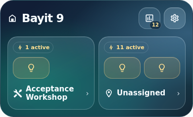

# Bayit 9

A room-based Liquid Glass dashboard for Home Assistant, with a compact home screen, device shortcuts and room controls. Start with your Home Assistant areas and customize which rooms and devices appear.

[הוראות בעברית](docs/install.he.md) · [Heating profiles](docs/heating.md)

[Room controls in the example home](docs/screenshots/room.png)

## Install Bayit 9

The **Community dashboards** picker requires Home Assistant 2026.5 or newer. Bayit 9 builds its rooms from your Home Assistant areas and device assignments. Devices without an area appear together by default.

- **Home Assistant 2026.11 and newer.** Open **Settings → Marketplace → Add from link**, connect your GitHub account when prompted, and enter `yahavzarfati/bayit-9`. Open the repository and select **Install**. [Marketplace instructions](https://www.home-assistant.io/integrations/marketplace/#custom-repositories)
- **Home Assistant 2026.5–2026.10 with HACS.** In **HACS → Custom repositories**, add `yahavzarfati/bayit-9` as a **Dashboard** repository and download it. For a preview release, enable **Show beta versions** in the Bayit 9 menu.

Reload Home Assistant after the download. In the Companion app, close and reopen the dashboard view. Then open **Settings → Dashboards → Add dashboard → Community dashboards → Bayit 9**.

As a Home Assistant administrator, open the gear in Bayit 9 and choose **Edit dashboard**. Open **Manage rooms** to reorder, hide, or restore rooms. Use **Manage devices** on a room card to arrange or hide controls for that room. In automatic mode, new areas and devices continue to appear. You can also add a dashboard-only room and edit room names, icons, and shortcuts from Home. Select **Save dashboard** to apply changes on all devices.

Each room card can show up to six shortcuts. For YAML-managed dashboards, use the [strategy options](docs/configuration.md). Bayit 9 starts in the Home Assistant language and supports English and Hebrew.

## Controls and preferences

- Lights, switches, covers, fans, climate and locks use the entities and permissions you already have in Home Assistant.
- Tap a shortcut to act and hold it to open the device’s own controls. With a keyboard, use **Shift+Enter** on a shortcut to open those controls.
- Open **Find rooms and devices** in Bayit 9 Settings. Search by name, room, or device type and mark favorites for this browser and user.
- From **Manage rooms**, open **Room layouts** to bind a built-in layout or reuse another room's groups with the current room's devices. The dashboard saves changes when you choose **Save dashboard**.
- Automatic rooms can offer confirmed group commands for lights or covers. Choose the room's group control setting to show or hide them.
- Room panels group lights, covers and climate controls. A light tile acts immediately, and holding it opens adjustable controls such as brightness when the device supports them.
- The optional home overview brings selected locks, people, calendars and sensors together on the toolbar.
- Other entities can open their native Home Assistant controls from the room.
- Timed climate and heating controls can read the countdown and daily use from an existing Simple Timer integration or use mapped Home Assistant timers and scripts for heating.
- Configure the toolbar and additional screens in **Customize home**. These can include household presence, weather and sun, electricity and water, native media and vacuum controls, and a combined agenda.
- The appearance panel has built-in and shared wallpaper choices. Add pictures already served by Home Assistant under **Customize home → Appearance → Shared photos**. An administrator can save a shared or built-in wallpaper as the household default. Photos added through **My photo** stay in the current browser.
- An optional full-screen dashboard hides the Home Assistant chrome on that view. The **Home Assistant menu** button in Bayit 9 Settings brings it back.

Home Assistant manages room assignment and access to devices. Bayit 9 runs in the frontend and uses the same connection as other dashboards.

## Manual configuration

If Lovelace resources are managed in YAML, add the resource URL displayed by HACS as a `module` in the Lovelace resource list. Then configure a dashboard with this strategy, either in YAML or through the strategy editor.

    strategy:
      type: custom:bayit-9

See [configuration options](docs/configuration.md) for examples.

## Development

See the [Dwains Dashboard Next comparison](docs/dwains-adaptation.md) for the design decisions and verification scope.

Use Node.js 22 or later.

    npm ci
    npm test
    npm run build
    npm run check:dist

The build produces `dist/bayit-9.js`, the browser module installed by HACS.

Run `npm run test:browser` after building to run all dashboard and standalone browser suites. For a focused edit, select one or more dashboard scenarios by name in Chromium and WebKit.

    npm run test:browser -- --scenario "Room cover columns" --scenario "Immediate room light reversal"

Scenario names match case-insensitively and accept a partial name. A name that matches nothing fails the run. Run standalone checks by filename, for example `node test/weather-forecast-browser.mjs`. Before a release, run the complete package checks against the same built candidate.

## License

Bayit 9 is available for installation and use with Home Assistant. See [License](LICENSE.md).
